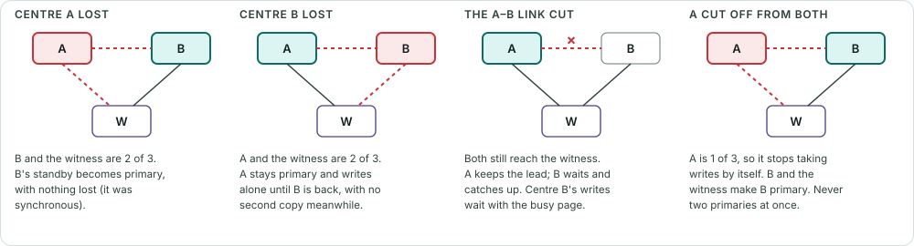
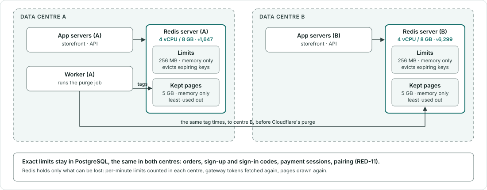

# Lytro's data layer, self-managed

Status: a proposal, 2026-11-20. This is how we would run PostgreSQL and Redis ourselves across the two data centres,
with no managed database service (DAT-19). It covers:
- replication;
- how one server is chosen to lead, and how the apps find it;
- backups and the settings;
- the routine work;
- what each failure does.

It sits under `TWO-DATA-CENTRES.md`. Patroni, etcd and HAProxy aren't in the repo yet; this proposal would add them.
Nothing here is built.

## In short

- **PostgreSQL: one primary, one synchronous standby.** The primary is in centre A and the standby in centre B.
  Patroni chooses which server leads, using an etcd quorum of three: A, B, and a witness at a third provider.
- **Data lost when the primary dies: none, while both run.** Each commit waits until B has written it, which adds 1–3
  ms. If B is down, writes carry on alone instead of stopping, and the risk of loss returns until B is back.
- **Redis: two instances in each centre, nothing shared.** One holds the per-minute limits and one the kept pages,
  both in memory only. Losing one slows Lytro down but never stops it. Exact limits stay in PostgreSQL.
- **The cost at 2,000 shops: about ৳62,900 a month.**

  | Part | A month |
  | --- | --- |
  | The primary | ৳11,976 |
  | The standby | ৳41,999 |
  | The witness | about ৳1,000 |
  | Redis | ৳1,647 + ৳6,299 |

  That's part of the two-centre total of ৳1.49 lakh.

## PostgreSQL across two centres

- **How the apps find the leader:**
  - Patroni runs beside PostgreSQL on both database servers and keeps the leader's lock in etcd.
  - HAProxy on every app server checks Patroni's health endpoint, so the apps always reach whichever server holds the
    lock.
  - A failover moves only the leader. HAProxy notices within seconds, and no app setting changes.
- **Centre B's reads stay inside centre B;** only its writes cross the tunnel.
- **The old primary rejoins as a standby** (`pg_rewind`), never as a second primary.

## Who may lead, and how two primaries are prevented

The rule behind every case: a server may lead only while it holds the leader's lock in etcd, and the lock needs 2 of
the 3 members. That's why the witness sits at a third provider. A cut between A and B can then never leave each centre
thinking it alone is in charge.

## PostgreSQL's settings

The settings are the same on both servers, so a standby can always become the primary. The settings DAT-35 names,
which a standby may not have lower than the primary, are kept identical.

| Setting | Value | Why |
| --- | --- | --- |
| `shared_buffers` / `effective_cache_size` | 16 GB / 48 GB | A quarter of 64 GB for PostgreSQL's own cache; the 20–30 GB of hot data fits. |
| `work_mem` / `maintenance_work_mem` | 8–16 MB / 1–2 GB | Sorts per query; vacuum and index builds. |
| `max_connections` | 150 | The PgBouncers on 6 app servers, the workers and monitoring. Identical on both servers. |
| `synchronous_commit` | `remote_write` | A commit returns once B has written it. This is Patroni's synchronous mode, not strict: if B is down, writes carry on. |
| `max_slot_wal_keep_size` | 50 GB | A standby that falls far behind can't fill the primary's disk; it's rebuilt instead. |
| `hot_standby_feedback` | on | The primary's clean-up doesn't cancel centre B's reads, at the cost of some bloat. |
| `archive_timeout` | 60 s | WAL reaches R2 within a minute, even when quiet (D9-18). |
| `statement_timeout` / transactions | 10 s / 5 s | As built in 9.2, with the worker's own 60 s for long jobs. |
| `checkpoint_timeout` / `max_wal_size` | 15 min / 16 GB | Fewer, smoother checkpoints on NVMe. |

## Redis in each centre

Nothing in Redis is shared between centres or written to disk. A shopper stays in one centre (the load balancer's
session affinity), so each centre counts its own per-minute limits. The one thing both centres must hear about is a
cleared page, so the purge job writes to both.

**How each instance is set up:**
- **Limits:** 256 MB, evicting only keys with an expiry (`volatile-lru`), as built today.
- **Kept pages:** about 5 GB at 2,000 shops, evicting the least-used page (`allkeys-lru`).
- **Both:**
  - nothing on disk (`save ''`, and no append-only file);
  - a password given on standard input;
  - FLUSHALL, FLUSHDB, CONFIG, DEBUG, KEYS and SHUTDOWN switched off;
  - reachable only on the centre's private network (RED-01).
- **A restart starts empty.** The limits rebuild within a minute, and pages within a few minutes of traffic.

**Why there's no Redis failover yet:** losing Redis slows Lytro down but never stops it. Each API process falls back to
its own share of every limit (RED-05, stricter for codes and orders), and pages are drawn again until Redis is back. A
Redis replica with Sentinel would turn those minutes into seconds. It becomes worth it at about 5,000 shops, when
drawing every page again would strain the app servers.

## The routine work we take on

Self-managed means all of this is ours. Each task has a script and a runbook, and the drills are recorded in
`docs/drills/`.

| Task | How | How often |
| --- | --- | --- |
| Backups | WAL-G sends WAL to R2 every minute from whichever server leads. A base backup and the encrypted dump run nightly at 05:30 (D9-18). The buckets are locked against deletion. | Continuous, and nightly |
| Restore drills | The latest dump restored into a scratch database and counted; a restore to a chosen minute; one shop's rows (DAT-29). | Monthly; quarterly |
| Switchover drill | `patronictl switchover` to centre B and back, in a quiet hour, timing how long until orders work again. | Quarterly |
| Minor upgrades | The standby first, then a switchover, then the old primary. Writes wait under a minute at each step. | When a release fixes something we use, or every 3 months |
| Major upgrades (17 to 18) | A new standby built on the new version by logical replication, checked, then a switchover. Planned, with its own read. | Yearly at most |
| Rejoining an old primary | `pg_rewind`, or a fresh base backup, then it streams as a standby. It's never started as a primary (DAT-37). | After each failover |
| Vacuum and bloat | Autovacuum tuned for the busiest tables (orders, outbox, card facts), and a weekly report of the largest tables, dead rows and index bloat. | Weekly |
| Watching | Alerts for replication lag over 5 s, WAL archiving failing, disk over 75% and over 85%, connections near the limit, long transactions, CPU steal over 5%, an etcd member down, and either Redis down or evicting. | Always |
| Settings audit | Both servers' settings compared; the ones DAT-35 names must match. | After each change, and monthly |
| Secrets | Database and Redis passwords rotated. Replication runs over TLS inside the WireGuard tunnel. | Twice a year |

## What each failure does

| What fails | What happens | Data lost |
| --- | --- | --- |
| PostgreSQL crashes on the primary | Patroni restarts it in place. If it won't start within about 30 s, B is promoted. | none |
| The primary's server, or all of centre A | B and the witness agree, B is promoted, and HAProxy sends writes to it. About 1–2 minutes. | none (synchronous) |
| The standby's server, or all of centre B | A carries on alone, no longer waiting for B. Centre B's shoppers move to A. | none, but nothing has a second copy until B is back |
| The link between A and B | A keeps the lead. B falls behind and catches up when the link returns; centre B's writes wait meanwhile. | none |
| The witness | Nothing, until a second failure. It's alerted and replaced within a day. | none |
| The primary's disk fills | Alerts at 75% and 85% (ServerDiskHigh). A standby far behind can't hold more than 50 GB of WAL. | none, if acted on |
| A bad migration or a mistaken delete | Restored to the minute before it, into a new server or a scratch database, or one shop's rows alone (DAT-26). | back to that minute |
| Limits Redis | Each process takes its share of every limit (RED-05). Exact limits are unaffected. | nothing kept |
| Kept-pages Redis | Pages are drawn again, and the app servers work harder until it's back. | nothing kept |

## For the owner to decide

| Decision | Recommendation | What it changes |
| --- | --- | --- |
| Patroni (automatic), or the one command we have | **Patroni**, with etcd on both database servers and the witness, once both centres run and a drill passes | Amends D9-2, DAT-37 and OD-37. The failover scripts become `patronictl` steps. |
| Synchronous or asynchronous standby | **Synchronous** (`remote_write`), not strict | Adds 1–3 ms to each commit (orders, saves). No data is lost on failover while both run. |
| Redis failover | **Not yet**, since the fallbacks cover it. Sentinel at about 5,000 shops. | Nothing now |
| Where the witness runs | **The smallest VPS at a third provider**, neither CloudXen nor centre B's | About ৳1,000 a month; it holds no data |

## Sources

- **Requirements and decisions:** DAT-19, DAT-26, DAT-29, DAT-35, DAT-37, RED-01, RED-05, RED-11, D9-2 and D9-18.
- **What's built today:** the database and Redis from Slices 9.2 to 9.4 (`deploy/compose.yml`, `deploy/database`).
- **Sizes:** from `SCALING-TO-2000-SHOPS.md`.
- **Prices:** those of 2026-11-20, in `TWO-DATA-CENTRES.md`.
- **Timings:** estimates until a switchover drill measures them.
