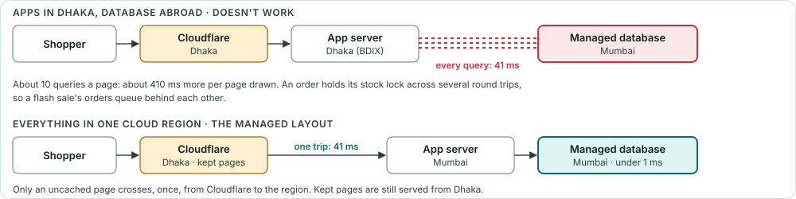
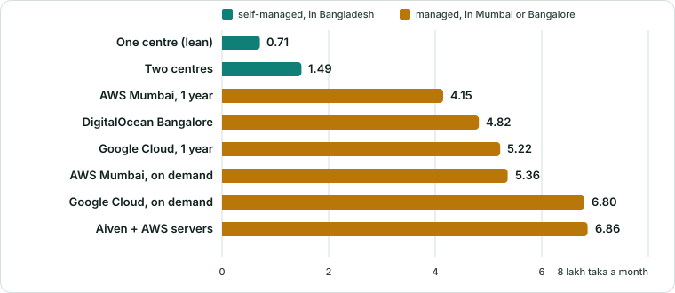

# Lytro on a managed cloud

Status: a proposal, 2026-11-20. The owner asked for "a seperate doc with fully managed third party database and redis
layer".

This doc covers the alternative to running the database and Redis ourselves: renting them fully managed from AWS,
DigitalOcean, Google Cloud or Aiven, which then handle patching, failover and backups.

It conflicts with a settled requirement, so choosing it means amending that:
- **DAT-19:** self-managed, on Bangladeshi BDIX servers, with no managed database.
- **D9-24 and D9-30:** the production server.

It sits beside `TWO-DATA-CENTRES.md` and `DATA-LAYER.md`. Nothing here is bought or built.

## In short

- **The catch: everything moves to Mumbai or Singapore.** No major cloud sells managed PostgreSQL or Redis in
  Bangladesh. With the database abroad, every query from a Dhaka server would cross the sea, so the app servers must
  move into the same region.
- **Uptime: three buildings in one region, backed by the provider.**
  - A region has two or three zones, each a separate data centre, and the provider handles a zone failing
    automatically.
  - The providers' uptime promises run from 99.95% to 99.99%, with credits when missed.
- **The cost at 2,000 shops: about ৳4.2–6.9 lakh a month.**
  - AWS Mumbai with a 1-year commitment is about ৳4.15 lakh.
  - Two self-managed centres cost ৳1.49 lakh, and one centre ৳71,260.
  - The gap is mostly server prices: about $143 a month for an 8 vCPU cloud server, against $25.20 at CloudXen.
- **My view: stay self-managed in Bangladesh for now.**
  - Managed costs 3 to 4.5 times as much.
  - It adds risks a Bangladeshi shop platform feels:
    - data held abroad;
    - payment and courier services called from foreign addresses;
    - every uncached request crossing international links.
  - Its real gain is less routine work for us.

## Why the app servers have to move too

From Dhaka, Mumbai averaged 41 ms and Singapore 48 ms (WonderNetwork, 2026-11-06 to 11-20). Inside one cloud region a
query takes under a millisecond. So the database and the apps belong in the same place, and only the page itself
crosses the sea. An order holds its stock lock across several round trips, so a database abroad would also make a
flash sale's orders queue behind each other.

## The layout

A cloud region is two or three zones, each its own data centre a few kilometres apart, joined by fast private links.
So the managed layout already spans several buildings, which is the two-centre design's goal, inside one region. The
apps still run in containers on the servers, as today; only PostgreSQL and Redis become the provider's.

## What it costs at 2,000 shops

Prices were verified on each provider's own price list or page on 2026-11-20, at Bangladesh Bank's 124.75 taka to the
dollar. The workload is the same for every provider:
- PostgreSQL with a standby in another zone (8 vCPU / 64 GB / 1 TB);
- two Valkey clusters, each with a replica;
- 9 servers of 8 vCPU / 16 GB;
- 3 TB a month of data sent out;
- a NAT gateway.

Each total adds about $250 for Cloudflare, R2 and monitoring, as the self-managed totals do.

| A month, Mumbai (or Bangalore) | AWS | DigitalOcean | Google Cloud | Aiven + AWS servers |
| --- | --- | --- | --- | --- |
| PostgreSQL with a standby, 1 TB | RDS Multi-AZ r7g.2xlarge: $1,588 + $262 storage | Advanced, 8 vCPU / 64 GB ×2: $1,578 | Cloud SQL Enterprise Plus HA: $1,771 + $408 storage | Business-64, 2 nodes: $2,860 |
| Valkey ×2 clusters, each with a replica | r7g.large ×2 nodes: $262 each | 4 vCPU / 8 GB + standby: $240 each | 13 GB ×2 nodes: $292 each | Business-8: $358 each |
| 9 servers, 8 vCPU / 16 GB | c7g.2xlarge: $143 each | CPU-Optimized: $168 each | c4a-highcpu-8: $230 each | AWS c7g.2xlarge |
| Data out, 3 TB | $336 | included | $348 | as AWS |
| **Workload, on demand / 1 year** | **$4,049 / $3,080** | **$3,610 / none offered** | **$5,199 / $3,935** | **$5,253 / $4,817** |
| **With Cloudflare, R2, monitoring (≈ $250)** | **৳5.36 / ৳4.15 lakh** | **৳4.82 lakh** | **৳6.80 / ৳5.22 lakh** | **৳6.86 / ৳6.32 lakh** |
| Uptime promise (database) | 99.95% (RDS Multi-AZ) | 99.95% (with a standby) | 99.99% (Enterprise Plus HA) | 99.99% |
| Restore to any minute | up to 35 days (14 chosen) | **7 days only** | up to 35 days | 14 days |
| Singapore instead | $5,176 / $3,858 | the same price | $6,060 / $4,568 | $6,243 / $5,507 |

**Ways the total moves:**
- **Fewer servers:** six instead of nine would still carry a zone going dark, and save about $430–500 a month.
- **A read replica:** adds about $790–1,090.
- **A disaster-recovery replica in Singapore:** adds about $790–1,300.

## Self-managed or managed, side by side

| | Two centres, self-managed (Dhaka) | Managed cloud (Mumbai) |
| --- | --- | --- |
| A month at 2,000 shops | ≈ ৳1.49 lakh | ≈ ৳4.15–6.9 lakh |
| A data centre failing | 1–2 min with Patroni; 15–45 min by one command | about 1–2 min, by the provider |
| The whole region or city failing | both centres are in Dhaka, so restore from R2 | with a Singapore replica, promoted in 15–30 min |
| Uptime promise | none from Bangladeshi providers; our own target is 99.95% | 99.95–99.99%, with credits |
| Routine work | ours: Patroni, etcd, backups, upgrades, drills | the provider does patching, failover and backups; ours: our dump, drills, the apps |
| Shoppers' uncached pages | served inside Bangladesh, over BDIX | about 41 ms more, over international links |
| An international link cut | shops stay reachable inside Bangladesh | shops' uncached pages, orders and dashboards are cut off |
| Where shoppers' data lives | Bangladesh | India or Singapore: check the law and our privacy policy |
| bKash, couriers, SMS | called from Bangladeshi addresses | called from a foreign address: check each allows it |
| Paying the bill | in taka, locally | in dollars abroad, about $3,300–5,500 a month: check the bank's limits and Bangladesh Bank's rules |
| Moving away later | our own scripts, any provider | a migration out of the provider |

## What would change for us

**The provider takes over:**
- **Patching and minor upgrades** of PostgreSQL and Valkey, in maintenance windows we set.
- **Failover between zones.** We'd run no Patroni, etcd, witness or HAProxy of our own.
- **Continuous backups** with restore to any minute: 14 days, or 7 on DigitalOcean.
- **The disks,** their replacement, and the servers under the database.

**Still ours:**
- **The app servers,** the deploys, and the containers on them, much as today.
- **Our own nightly encrypted dump to R2,** as the copy kept apart from the provider (D9-18's separate bucket).
- **Restore drills,** and restoring one shop (DAT-26, DAT-29).
- **Major upgrades:** the provider runs them, but we test and schedule them.
- **Watching:** the provider's figures go into Grafana, with our alerts.

| Change in the code or the deploy | Why |
| --- | --- |
| Connection settings point at the provider's endpoints | A failover moves the provider's address and nothing else changes. PgBouncer stays on each app server. |
| Migrations run as the provider's admin role | Managed PostgreSQL has no full superuser. The role scripts (`10-app-role.sh`) and pg-boss's schema set-up need checking against it. |
| WAL-G and the backup container are retired | The provider keeps the WAL. Our restore scripts become the provider's restore, plus our dump. |
| Redis connections use TLS and the provider's password | Managed Valkey already blocks the dangerous commands we switch off ourselves today. |
| The purge job writes to the one kept-pages cluster | One region means one cache, which is simpler than two centres. |
| Allowlists move to the NAT gateway's address | This covers R2's backup keys and any provider that allows callers by address. |
| The compose file loses its database, PgBouncer-to-database, backup and Redis services | They become the provider's. |

## For the owner to decide

| Decision | Recommendation | What it changes |
| --- | --- | --- |
| Managed, or self-managed | **Self-managed in Bangladesh** (`TWO-DATA-CENTRES.md`), for cost, local reach and keeping the data at home. Revisit managed if the routine work becomes the bottleneck, or a shop's contract needs a provider-backed promise. | Managed would amend DAT-19, D9-24 and D9-30 |
| If managed: which provider | **AWS Mumbai with a 1-year commitment**, the cheapest with 14-day restore and three zones. DigitalOcean is simpler but keeps only 7 days of restore. | D9-18's 14 days of restore rule out DigitalOcean unless amended |
| Before any managed move | Three checks. Does Bangladeshi law or our privacy policy need shoppers' data kept in Bangladesh? Do bKash, the couriers and BulkSMSBD accept calls from a foreign address? Will the bank allow a monthly dollar payment of this size? | Any one of them can rule it out |

## Sources

- **Prices**, verified on 2026-11-20:
  - AWS's published price lists for RDS, ElastiCache, EC2, data transfer, VPC and Savings Plans (published 2026-11-19
    and 11-20);
  - DigitalOcean's pricing pages and docs;
  - Google Cloud's SKU price list, and the Cloud SQL and Memorystore pricing pages;
  - Aiven's public pricing API.
- **Uptime promises:** each provider's service level page.
- **Latency:** WonderNetwork's Dhaka ping tables, 2026-11-06 to 11-20. Real paths through Bangladeshi networks vary.
- **Not included in the prices:** backup storage past the free allowance, faster storage, traffic between zones, boot
  disks, support plans and taxes.
- **AWS's 1-year figures** are without upfront payment.
