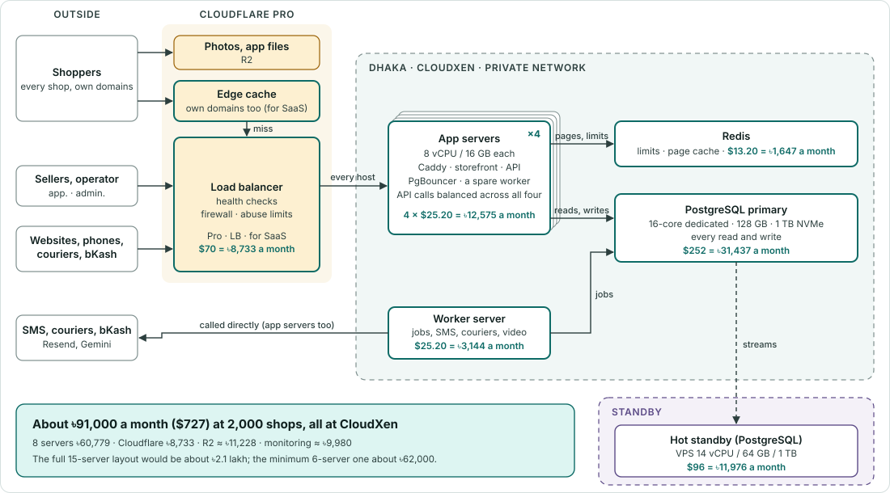
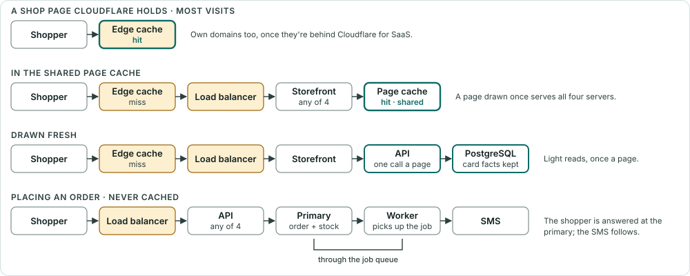
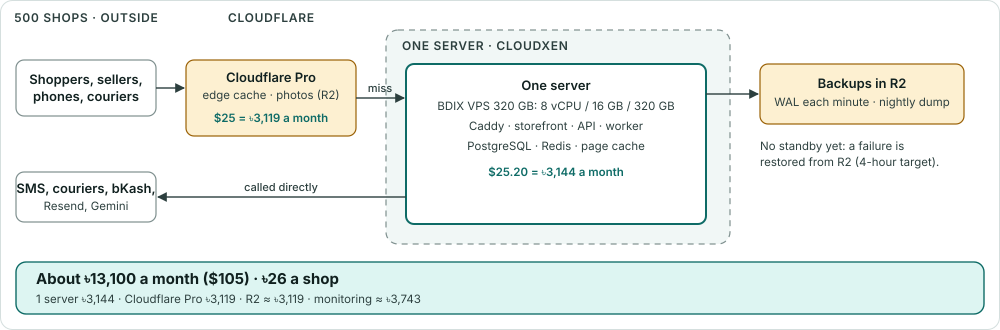
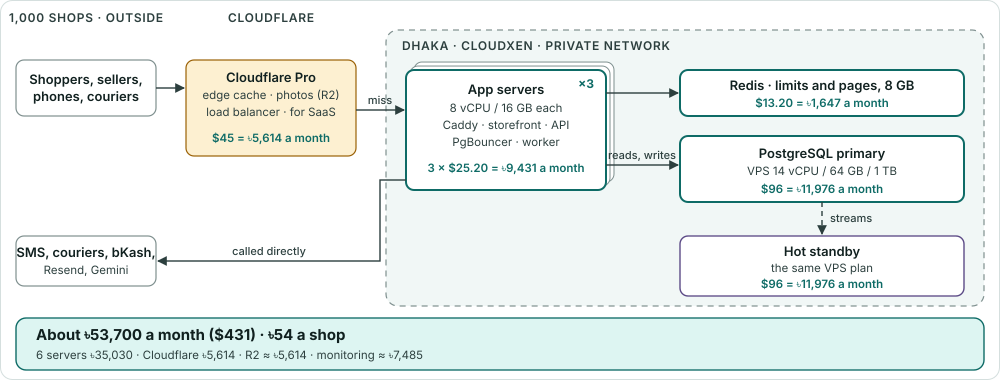
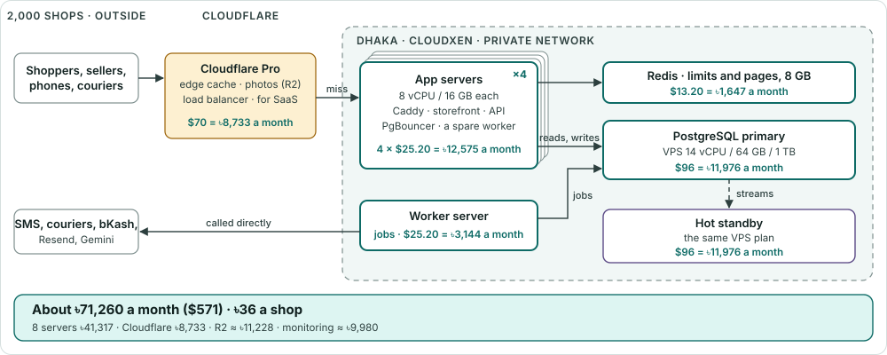
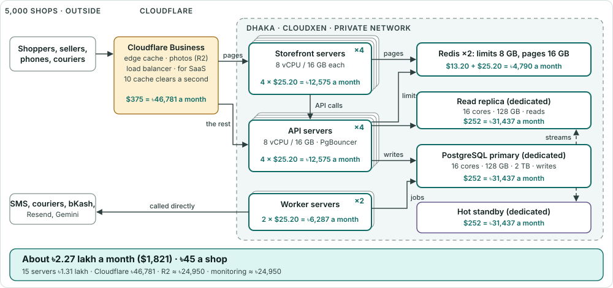

# Scaling to 2,000 shops: the lean layout

Status: a proposal, 2026-11-20. The owner chose this lean layout, all at CloudXen, over a fuller 15-server one. Nothing
here is bought or built yet. The database runs on a VPS and moves to a dedicated server only when its measurements
call for it (the owner, 2026-11-20). The server layout, Redis and shops' own domains are settled in the SRS and the Phase 9
plan (DAT-19, RED-01, D9-32), so each step below amends them when the owner approves it. The numbers come from
staging's load runs (`SYSTEM-UNDER-LOAD.md`) and the back-of-the-envelope estimate below. A 2,000-shop load test on a
rented production-size copy (D9-34) confirms them before anything is bought.

## In short

- **The load:** 2,000 shops at 500 orders a month each, with 1% of visits placing an order. That's 1 million orders
  and 100 million visits a month. About 300 requests a second reach the server at the evening peak, and about 610 in
  a 10× spike. Cloudflare answers the rest.
- **The layout: 8 servers.**
  - 4 app servers, each running the storefront and the API;
  - 1 worker server and 1 Redis server;
  - a PostgreSQL primary and its hot standby, each on a 1 TB VPS;
  - all behind Cloudflare Pro with its load balancer.
- **The cost:** about ৳71,000 ($571) a month, or ৳36 a shop. A dedicated database server would make it about
  ৳91,000, and the full 15-server layout about ৳2.1 lakh.
- **It depends on the three code fixes:** card facts kept per shop, one catalogue read per page, and limits per
  shopper. With them, the layout carries a 10× spike even with one app server down.

## The estimate

**Assumptions:**
- A visit is 4 pages.
- The evening peak is 4 times the day's average, and a spike is 10 times.
- Cloudflare answers 85% of browsing pages, and the page cache half of what's left.
- Cart, checkout, tracking and account pages (about 7.5% of page views) always reach the server.

| | A month | A day | Average | Evening peak | 10× spike |
| --- | --- | --- | --- | --- | --- |
| Orders | 1,000,000 | 33,000 | 0.4/s | 1.5/s | 3.9/s |
| Visits | 100 M | 3.3 M | 39/s | 154/s | 386/s |
| Page views | 400 M | 13.3 M | 154/s | 617/s | 1,540/s |
| Requests reaching the server | | | | ≈ 300/s | ≈ 610/s |

The 300 a second at the peak break down as:

| Where they come from | Per second |
| --- | --- |
| Browsing pages Cloudflare didn't have (half answered by the page cache) | 86 |
| Cart, checkout, tracking and account pages | 46 |
| In-page calls such as the delivery charge | 77 |
| Sellers' dashboards | 75 |
| Couriers and listener phones | 10 |
| Orders | 1.5 |

## The lean layout

Any app server answers any request, so losing one costs a quarter of the capacity, not a whole kind of server. Each app
server runs Caddy, the storefront, the API, PgBouncer and a spare worker process. The storefront's calls to the API are
balanced across all four. The costs are monthly, at CloudXen's prices read on 2026-11-20.

## How a request is served

Orders and stock stay on the one primary, where the stock ledger keeps them exact. Browsing reads are light once card
facts are kept and each page asks the API once.

## Does it fit?

Staging measured how much CPU each request takes, split by part: about 40 ms in the storefront, API and Caddy, 13 ms in
the database, and 4 ms in jobs. These are from the 0.6× run of 2026-11-19, on CloudXen's own Xeon cores.

| Part | Evening peak | 10× spike | The lean layout has |
| --- | --- | --- | --- |
| Storefront + API | 12 cores (8 after the fixes) | 24 cores (17 after) | 4 × 8 vCPU = 32; with one server down, 24 |
| Database | 4 cores (under 2 after) | 8 cores (about 3 after) | 14 vCPU, 64 GB: about 45% busy in a spike |
| Jobs | about 1 core | about 2 cores | an 8 vCPU worker server, plus a spare worker process |
| Redis | shared limits and 4–8 GB of kept pages | | 8 GB |

**Data:** about 15 KB an order with its lines, stock moves and indexes, so 180–190 GB a year. That's about 3 years on 1
TB of NVMe. The data read most often fits in the database server's 64 GB of memory: the last month's orders, the
catalogues and the customers, about 20–30 GB in all.

**Bandwidth:** the servers send about 50 Mbps at the peak and 100 Mbps in a spike, well within their 1 Gbit/s ports.
Cloudflare serves the rest: about 8 TB of pages and 120 TB of photos a month.

**Database writes** are far from any limit: 1.5 orders a second at the peak, about 50 rows a second.

Without Cloudflare's cache, a spike would need about 120 cores, more than even the full layout has. The cache is what
the layout rests on.

## What it costs

All at CloudXen, with prices read on its own pages on 2026-11-20, converted at Bangladesh Bank's rate of 124.75 taka to
the dollar.

| What | Each, a month | A month |
| --- | --- | --- |
| App servers ×4 (BDIX VPS 320 GB: 8 vCPU, 16 GB, 320 GB NVMe) | $25.20 | ৳12,575 |
| Worker server ×1 (the same plan) | $25.20 | ৳3,144 |
| Redis server ×1 (BDIX VPS 150 GB: 4 vCPU, 8 GB) | $13.20 | ৳1,647 |
| Database primary (BDIX VPS 1 TB: 14 vCPU, 64 GB, 1 TB NVMe) | $96 | ৳11,976 |
| Hot standby (BDIX VPS 1 TB: 14 vCPU, 64 GB, 1 TB NVMe) | $96 | ৳11,976 |
| Cloudflare: Pro, a load balancer for the 4 app servers, Cloudflare for SaaS | $70 in all | ৳8,733 |
| R2: photos and backups (estimate) | ≈ $90 in all | ৳11,228 |
| Monitoring: Grafana Cloud Pro, Sentry Team, UptimeRobot Solo (estimate) | ≈ $80 in all | ৳9,980 |
| **Total** | | **≈ ৳71,260 ($571)** |
| Per shop | | ≈ ৳36 |
| The same with a dedicated database primary (Ryzen 9 5950X: 16 cores, 128 GB, $252) | | ≈ ৳90,720 ($727) |

**Three ways to buy it:**

| | Lean (chosen) | Full | Minimum |
| --- | --- | --- | --- |
| App servers (8 vCPU) | 4, storefront and API on each | 3 storefront + 4 API | 3, storefront and API on each |
| Worker servers | 1, plus a spare worker process | 2 | 1, with Redis on it |
| Redis | 1 small server | 3 servers | on the worker |
| Database primary | VPS (14 vCPU / 64 GB) | dedicated | VPS (14 vCPU / 64 GB) |
| Read replica | none until the primary is half busy | dedicated | none |
| Hot standby | VPS | dedicated | VPS |
| Cloudflare | Pro | Business | Pro |
| Servers | 8 | 15 | 6 |
| A month | ≈ ৳71,260 ($571) | ≈ ৳2.09 lakh ($1,672) | ≈ ৳62,100 ($498) |
| Per shop | ৳36 | ৳104 | ৳31 |
| A 10× spike with a server down | carried | carried easily | busy pages until it's back |

**Why a VPS for the database, and when it moves:**
- **It's enough for this load.** Once card facts are kept, a spike needs about 3 fast cores, roughly 6 of the VPS's
  Xeon cores, so the 14 vCPU plan is about 45% busy. Its 64 GB holds the 20–30 GB of hot data.
- **A dedicated server's faster cores would barely show.** They are 1.5 to 2 times as fast, but that saves only 2–3 ms
  on a page's light queries.
- **The risk is neighbours on shared cores.** Monitoring watches CPU steal time. The primary moves to a dedicated
  server, built as a replica and then promoted, once any of these happens:
  - steal passes about 5%;
  - reads from memory fall below about 99%;
  - its CPU passes half at the evening peak;
  - queries slow.
- **The primary and the standby are the same plan,** so a failover keeps the same capacity.

**What the lean layout gives up:**
- **The storefront and API share servers,** so a viral shop's browsing competes with dashboards and orders. Cloudflare
  takes most browsing, and a CPU cap on the storefront (say 5 of 8 cores) keeps 3 cores of every server for the API.
- **No read replica.** The primary takes every read, about a quarter of its capacity even in a spike.
- **One Redis.** If it fails, each process keeps its own share of every limit, and pages are drawn again until it's
  back: slower, not down.
- **One worker server.** If it fails, a spare worker process on an app server keeps SMS, couriers and notifications
  moving.
- **A VPS database.** The primary and its standby share their cores with other customers. They move to a dedicated
  server when their measurements call for it (above).
- **Cloudflare Pro, not Business:** no 100% uptime promise and fewer firewall rules. Its 5 cache clears a second
  covers the 2–3 expected.

**About these figures:**
- **Bandwidth:** ask CloudXen to state its VPS plans' international bandwidth in writing (DAT-20). Also ask it to
  confirm that Cloudflare reaches the servers over BDIX, not the international link.
- **The standby's provider:** DAT-19 puts the standby at a different provider, so one provider's outage can't take
  both. With the standby at CloudXen, a CloudXen-wide failure stops Lytro until it's restored from R2's backups, which
  has a 4-hour target.
- **Stock:** several CloudXen dedicated servers showed as out of stock on 2026-11-20.
- **The load balancer's price:** the $5 for each server past the first two comes from secondary sources. Cloudflare's
  own page only says "from $5".
- **Assumed:** 400 shops on their own domains (100 included, $0.10 each after), about 2 TB of photos and 1 TB of
  backups in R2.
- **Not included:** SMS, email and Gemini (paid per use), staging, domains and people.

## What changes, and why

| Change | Why | Kind |
| --- | --- | --- |
| Keep card facts per shop | They took 68–86% of the database's time in every staging run. Kept per shop and refreshed within 5 minutes of a delivery or return (the owner, 2026-11-20). | Code, first |
| One catalogue read per page | A drawn page asks the API once instead of once per product row. | Code, first |
| Limits per shopper, not per address | Many mobile shoppers share one public address. Each shopper gets 120 requests a minute by a cookie, with 1,200 per address as the backstop. Orders get 10 per shopper and 60 per address (the owner, 2026-11-20). | Code, first |
| Four app servers, each with the storefront and the API | Any server answers any request, so one down costs a quarter of the capacity. Cheaper than separate kinds of server at this load. | Servers |
| Cloudflare in front of every host, with its load balancer | Health-checked balancing across the four, a firewall and abuse limits. Replaces the single Caddy door. | Cloudflare |
| Shops' own domains behind Cloudflare for SaaS | Today a viral shop on its own domain reaches the server for every page (KNOWN-GAPS §150). | Cloudflare |
| The database on its own server | Every read and write goes through it. A 1 TB VPS carries this estimate; a dedicated server comes when its measurements call for it. | Servers |
| Redis on its own server | One set of limits and one page cache shared by every server (D9-1). | Servers |
| A hot standby | If the primary fails, one command promotes it (DAT-37). | Servers |
| Deploys across servers | `deploy.sh` runs on one server today. It becomes: migrate once, then replace the app servers one at a time. | Code |

**These stay as they are:**
- PostgreSQL as the truth, with each shop's rows kept apart and the stock ledger exact.
- The job queue in PostgreSQL.
- Backups: WAL to R2 every minute, and the nightly encrypted dump.
- One image per app, built once in GitHub and tested on staging first.
- Photos from R2 through Cloudflare.

## The order to build it

Each step starts when production's measurements reach half of what the servers can take (DAT-55's trigger). The shop
counts are rough guides.

| Step | Around | What | A month, about |
| --- | --- | --- | --- |
| 1. Code fixes | now, before launch | Card facts kept per shop, one catalogue read per page, limits per shopper. | ৳3,144: the production server |
| 2. The database on its own server | 500–800 shops | The primary and its standby, each on a 1 TB VPS. Cloudflare Pro, for its faster cache clears. Paid monitoring. | ৳40,000 |
| 3. A second app server | 800–1,200 shops | Redis moves to its own server (an address change, D9-1). Cloudflare's load balancer goes in front of both app servers. Deploys learn to run across servers. | ৳46,000 |
| 4. The lean layout | 1,200–2,000 shops | Four app servers, and the worker on its own server. Shops' own domains go behind Cloudflare for SaaS. A 2,000-shop load test on a rented copy confirms it. | ৳71,000 |
| 5. Past the estimate | when measured | A read replica when the primary passes half busy, a dedicated database server if its measurements call for it, more app servers, then separate storefront and API servers (the full layout). | up to ৳2.1 lakh |

## How it grows: 500, 1,000, 2,000 and 5,000 shops

The same estimate (500 orders a shop a month, 1% of visits buying, the three code fixes in), scaled in a straight
line. The shape holds from about 1,000 to 5,000 shops. Below that it collapses to one server, and at 5,000 the database
and Cloudflare change kind. Grow by measurement, not by count: add a server when production shows a part at half its
capacity.

| | 500 shops | 1,000 shops | 2,000 shops | 5,000 shops |
| --- | --- | --- | --- | --- |
| Requests at the server, peak / spike | 75 / 150 a second | 150 / 305 | 300 / 610 | 750 / 1,525 |
| Storefront + API cores, peak / spike | 2 / 4 | 4 / 9 | 8 / 17 | 21 / 43 |
| App servers (8 vCPU) | 1 runs everything | 3, a worker on each | 4, plus 1 worker server | 4 storefront + 4 API, plus 2 workers |
| Database primary | on that server | 1 TB VPS | 1 TB VPS | dedicated, 128 GB, 2 TB |
| Read replica | none | none | none | dedicated |
| Hot standby | none, backups only | 1 TB VPS | 1 TB VPS | dedicated |
| Redis | on that server | 1 (8 GB) | 1 (8 GB) | 2: limits 8 GB, pages 16 GB |
| Cloudflare | Pro | Pro + load balancer | Pro + load balancer | Business + load balancer |
| Data a year / hot data | 47 GB / 6–8 GB | 95 GB / 10–15 GB | 185 GB / 20–30 GB | 475 GB / 50–75 GB |
| Servers | 1 | 6 | 8 | 15 |
| **A month** | **≈ ৳13,100 ($105)** | **≈ ৳53,700 ($431)** | **≈ ৳71,260 ($571)** | **≈ ৳2.27 lakh ($1,821)** |
| Per shop | ৳26 | ৳54 | ৳36 | ৳45 |

**500 shops:** one server runs everything, as at launch. A 10× spike would use about 85% of it, so the database moves
out soon after, once the server is half busy at the evening peak. With no standby yet, a failure is restored from R2
within the 4-hour target.

**1,000 shops:** the shape appears.
- The database gets its own VPS, with a standby.
- Three app servers sit behind Cloudflare's load balancer, and jobs run on a worker process on each one.
- A 10× spike still fits with one app server down.
- Per shop it costs the most here: the database, the standby and monitoring cost about what they do at 2,000 shops.

**2,000 shops:** the lean layout, drawn small beside the others. The full drawing is above.

**5,000 shops:**
- **The storefront and the API split** onto their own servers, so a viral shop can't slow anyone's dashboard.
- **The database goes dedicated, with a read replica.** Its 50–75 GB of hot data passes the VPS's 64 GB, and a spike
  would need more than its 14 vCPU.
- **Cloudflare moves to Business,** for 10 cache clears a second.
- **Disks:** CloudXen lists 1 TB on its dedicated servers, so the second disk has to be quoted.

**Grows by adding servers:**
- App servers, counted so that a spike still fits with one of them down.
- Workers, which share the job queue.
- Read replicas: the app already has a read connection to point at them.
- Redis, with a server each for the limits and the kept pages.

**Grows only by getting bigger:** the PostgreSQL primary. Every write goes to one server. At 5,000 shops that's about
1,000 rows a second in a spike, well within one server, so it needs a bigger machine, not more of them.

**Cautions:**
- Each size scales one estimate in a straight line and inherits its assumptions. Real shops vary, and one viral shop
  can look like a hundred.
- Above 5,000 shops, plan it fresh. The single primary, the job queue in PostgreSQL and deploying to 15 or more servers
  each need a design of their own.
- The shop counts are rough guides. The trigger for each step is production's measurements reaching half of a part's
  capacity.

## Sources

- **Load:** staging's load runs of 14, 18 and 19 November 2026 (2 vCPU / 3 GB, on CloudXen), with every container's
  CPU every 10 seconds (`SYSTEM-UNDER-LOAD.md`).
- **The estimate:** the assumptions stated above.
- **Prices, read 2026-11-20:**
  - CloudXen (panel.cloudxen.com: BDIX VPS and BDIX dedicated servers);
  - Cloudflare (plans, Load Balancing, Cloudflare for SaaS and R2 pricing);
  - Grafana Cloud, Sentry and UptimeRobot pricing;
  - Bangladesh Bank's exchange rate of 2026-11-19.

  Prices change; check them before buying.
- **The interactive page:** this doc was first written as an interactive page; this file is the copy kept in the repo.
