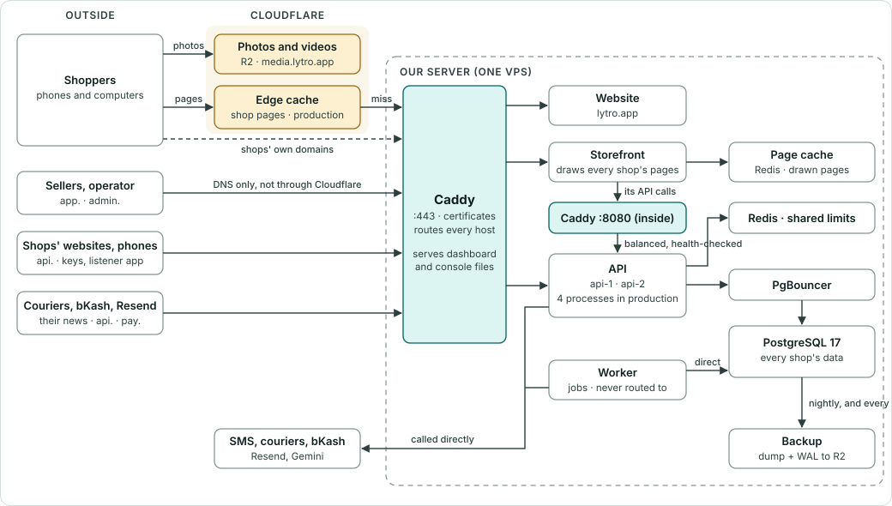
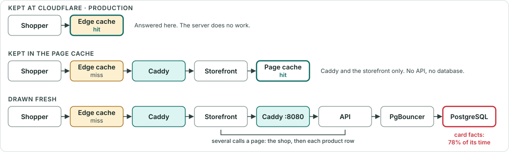
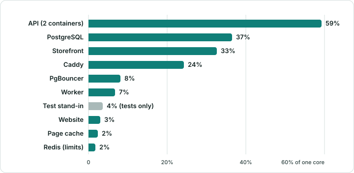

# Lytro under load

Status: written 2026-11-20 from staging's load runs of 14, 18 and 19 November (2 vCPU / 3 GB, no Cloudflare in front).
Production's own run (Phase 9 Slice 9.10, D9-35) replaces these numbers when it's done. `DEPLOYMENT.md` §2 and
`deploy/compose.yml` are the design; this is what the design did under load. It answers four questions: which part runs
out first, how to fix it, whether every request passes through Caddy, and when a shopper sees the busy page. Where it
goes from here, for 2,000 shops: `SCALING-TO-2000-SHOPS.md`.

## In short

- **What runs out first: the CPU.** Every container shares the same cores. Memory, disk, the database's connections and
  the network all had room to spare.
- **Every request that reaches the server enters through Caddy.** A freshly drawn shop page passes it twice. Photos, and
  in production most shop pages, are answered by Cloudflare and never reach the server.
- **Busy pages in production: rarely.** A page Cloudflare holds is never a busy page. Cart, checkout and freshly drawn
  pages can show it when the server is overloaded or a limit is reached.

## The system, part by part

Every arrow into the server ends at Caddy. Inside, the storefront (and the website, drawn without its arrow) reaches the
API through Caddy's internal listener, which balances api-1 and api-2 and skips one that fails its health check. The
database, both Redis stores and the outside services are reached directly.

**Through Caddy:**

- Shop pages Cloudflare doesn't answer: misses, English, signed-in shoppers, shops' own domains.
- The dashboard and console. Caddy serves their files itself and passes `/api` to the API.
- The public API, listener phones, couriers' and Resend's news, wallet returns, the payment page.
- The storefront's and website's own calls to the API, a second time, on `:8080`.
- The certificate check for a shop's own domain.

**Never through Caddy:**

- Photos and videos, straight from Cloudflare's R2.
- Shop pages Cloudflare already holds (production).
- Database calls: the API's through PgBouncer, the worker's direct.
- Redis, both stores.
- SMS, couriers, bKash, Resend and Gemini, called straight out.
- Backups to R2, the monitor's figures to Grafana, and deploys over SSH.

## One shop page, three ways

What a page costs depends on where it's found. English pages, signed-in shoppers and shops' own domains skip
Cloudflare's copy and start at Caddy, so they take the second or third row. Cart, checkout, tracking and the account
always take the third.

## What ran out first

On 19 November staging ran 10 minutes at the 100-shop peak (1×) with the page cache on. CPU averaged 96%, and the load
average sat at 15 on 2 cores. A quarter of the requests (25.5%) were answered busy, and the median request took 6.4 s.
Meanwhile memory was at 61% and swap under 100 MB. PostgreSQL ran about 3 queries at a time, with none waiting and
99.98% of reads served from memory.

Average CPU per container, as a share of one core, over the 1× run (19 November, 16:51 UTC). Staging has 2 cores, so
200% is everything. The containers used 178 of the 200, and the system itself took most of the rest.

**How it gives way:**

1. The cores are full, so every process gets less time.
2. Each request takes longer, so more are open at once.
3. Requests queue in Caddy and in the API.
4. After 10 seconds without an answer, the storefront stops waiting and shows the busy page (503). Since the load-test
   fixes (#371, #385, #408) that's always the busy page, never an error page.

**One query did most of the database's work: card facts** (`cardFacts` in
`packages/db/src/repositories/catalogue/public-catalogue.repository.ts`). For every product card in a list it works out
the "few left" count, how many orders the product was in, and the best-seller badge, going through the shop's delivered
orders every time a product list is drawn. It took 78% of the database's time in the 1× run, 68% at 0.6× with the page
cache, and 86% before the cache: about 35 ms a call on a calm server, 190–270 ms once CPU ran short. The drill reports
(`docs/drills/`) don't name it; it was found going back over the runs' query lists on 2026-11-20.

**What the page cache changed** (the same 0.6× load, 19 November):

| | Before the page cache | With it |
| --- | --- | --- |
| Requests that failed | 6.3% | 0.02% |
| Slowest 5% of requests | 16.6 s and over | 0.44 s and over |
| API reads, slowest 5% | 9.7 s | 0.43 s |
| Server CPU | 95% | 64% |

## How to resolve it

CPU runs out first, so three things help: skip the work, make each page cheaper, or add cores. Production gets
everything already built. The rest is in the order proposed; each needs the owner's yes.

**Skip the work (built):**

- Cloudflare's edge cache for shop pages (#380, D9-32): 5 minutes, search 1. Production only, switched on by the owner
  in Cloudflare's dashboard (`DEPLOYMENT.md` §9f).
- The page cache (#391, D9-33), on staging since 19 November; 1 GB in production.

**Make each page cheaper (next, proposed):**

1. **Keep card facts per shop** instead of working them out on every list. They change only when an order is delivered
   or returned, and a badge can be a few minutes old. This should save most of PostgreSQL's CPU. **Built in #411**
   (the owner's yes, 2026-11-20): kept in `tenant.product_card_facts`, at most 5 minutes behind the shop's orders.
2. **One catalogue read per page** instead of one per product row (planned, not started). Product lists were 42% of the
   API's time before the page cache.
3. Lighter dashboard polling, and the storefront's "load more" kept at Cloudflare.
4. Later, maybe: the storefront calling the API without passing Caddy again. It would save part of Caddy's 24%, but
   Caddy's health checks are what keep a deploy invisible, so not now.

**Add cores (built; then the production run decides):**

- Every core used (#387): 4 API processes and 3 storefront processes on production's 8 vCPU (D9-30).
- If production's ceiling run falls short of 10× the 100-shop peak (twice the 500-shop goal, D9-35): a bigger server, or
  a second app server with Redis moved to its own small VPS (D9-1). Database replicas come later (DAT-19).

## Do shoppers see a busy page in production?

Rarely. Most shoppers' pages come from Cloudflare, and Cloudflare never keeps or shows the busy page. When the server
answers busy, Cloudflare hands out the last good copy instead, for up to a day after it expired (`stale-if-error`,
`apps/storefront/src/lib/edge/edge-cache.ts`). The busy page can only appear on something that has to reach the server,
and only when the server is overloaded or a limit is reached.

**What the shopper sees** (`STOREFRONT-DESIGN.md` §7h): the shop's mark, "শপটি এই মুহূর্তে খুব ব্যস্ত" (The shop is very
busy right now), a Try again button, and a 30-second countdown after which the page tries again by itself. The cart is
kept.

| What the shopper opens | Answered by | Can it show busy? |
| --- | --- | --- |
| Home, category, product, landing page, search (Bangla, not signed in) | Cloudflare: 5 minutes, search 1 | No while Cloudflare holds a copy. Right after a seller's save clears that shop's pages, the next visit is drawn fresh, so it can if the server is overloaded at that moment. |
| The same pages in English, signed in, or on a shop's own domain | The page cache, otherwise drawn fresh | Only when the server is overloaded. A page-cache hit needs only Caddy and the storefront. |
| Delivery charge | Cloudflare, per product and area | Rarely. On a busy server it says "can't be shown right now · Try again", and the rest of the page stays. |
| "Load more" under a list | Our server (not at Cloudflare yet) | Only when overloaded: the same small message, under the list. |
| Cart, checkout, tracking, account, payment | Our server, every time | Yes, when overloaded. Checkout has its own busy words. |
| Placing an order | Our server, with limits | Past a limit: more than 180 orders a minute in one shop, or 10 a minute from one address in one shop (a flash sale). |

**What makes it appear:**

- The server answers busy (503), or doesn't answer within 10 seconds.
- One address sends more than 120 requests a minute to one shop (429, RTE-06).
- A restart longer than 10 seconds. Caddy holds requests up to 10 seconds for the storefront or API to come back
  (`lb_try_duration`), so a normal deploy shows nothing.

At the expected load, almost never: production's run passes only if fewer than 1% of requests fail at the 500-shop
peak, busy answers included, and its ceiling must reach twice that (D9-35).

**A risk to watch: shared mobile addresses.** Bangladeshi mobile networks put many phones behind one public address.
The 120-a-minute limit counts per address per shop (`request-limits.ts`, `ip:<shop>:<address>`). Pages from Cloudflare
and the page cache don't count, but each freshly drawn page makes several API calls. On a busy shop, many shoppers
behind one operator's address could reach the limit together and see the busy page. Phase 1 recorded this (D16: set the
limit against measured traffic). It's a platform setting (`public_requests_per_visitor_per_minute`), so raising it
needs no code. After launch, watch each shop's 429s.

## Each part: what it does, how it held up

| Part | What it does | Under load (staging, 1×) |
| --- | --- | --- |
| Cloudflare | lytro.app's DNS. In production it keeps shop pages for Bangla shoppers who aren't signed in, and clears a shop's pages when its seller saves. Serves photos and videos from R2 at media.lytro.app. | Not in front of staging. In production it should take most shop page visits. Its Free plan allows 5 purges a minute, so purges are batched. |
| Caddy | The only way in (ports 80 and 443). Certificates (lytro.app's wildcard, shops' own domains on demand), routing for every host, the dashboard's and console's files. Balances api-1 and api-2 and checks their health. Its `:8080` listener does the same for the storefront's and website's calls. | 24% of a core: TLS for every visitor, plus the second pass for the storefront's API calls. |
| Website | The marketing site at lytro.app (Next.js). | 3% |
| Storefront | Draws every shop's pages, on `*.lytro.app` and shops' own domains (Next.js). Asks the API for the shop, its products and their card facts. 1 process on staging, 3 in production. | 33%. Drawing pages is heavy; the page cache took most of it away. |
| Page cache | A Redis of the storefront's own that keeps drawn pages as long as Cloudflare would (5 minutes), English and own domains included, cleared by the same tags. 64 MB on staging, 1 GB in production. A full cache drops old pages; if it's down, pages are drawn again. | 2%. 46% of pages came from it. |
| API (api-1, api-2) | The NestJS server: the dashboard, the console, the public API, the storefront's data, the payment page, couriers' and Resend's news, the listener app. Two containers replaced one at a time, so deploys don't drop requests. 2 processes each in production. | 59%, the largest user, mostly answering the storefront's product lists. |
| Worker | Every background job: SMS, courier bookings, video conversion, nightly tasks. Never routed to. Talks to PostgreSQL directly. | 7%. Order SMS lagged 2–3 minutes behind (cause not found yet). |
| PgBouncer | Lets every API process share a small set of real PostgreSQL connections. When the API's own pool is full, the API answers busy at once. | 8% |
| PostgreSQL 17 | All the data. Each shop's rows are kept apart by row-level security. Its write-ahead log goes to R2. | 37%, mostly card facts. Never the limit: 3 queries at a time, none waiting. |
| Redis (limits) | The limits every process shares (per visitor, sign-ins, tracking) and wallet tokens. Keeps nothing on disk. If it's down, each process keeps its share of every limit. | 2% |
| Backup | The nightly encrypted dump and base backup to R2 at 05:30 Dhaka. PostgreSQL itself sends its log to R2 as it writes. | Not running during the tests. |
| Monitor | Grafana's Alloy agent: the server's, database's, Redis's and Caddy's figures to Grafana Cloud, once the owner's account is connected. | Small. |
| Outside services | BulkSMSBD, Steadfast, Pathao, RedX, bKash, Resend and Gemini, called directly by the API and the worker. | A stand-in answered for all of them during the tests, so nothing real was sent. |

## Sources

- Staging's runs: 14 November (shakedown, `docs/drills/2026-11-14-load-staging.md`), 18 November (recheck,
  `docs/drills/2026-11-18-load-staging-recheck.md`) and 19 November (passes at 15:14, 16:07 and 16:51 UTC: k6's
  summaries, every container's CPU every 10 seconds, and the database's 20 costliest queries, kept on the load
  machine).
- Code: `deploy/compose.yml`, `deploy/Caddyfile`, `apps/storefront/src/lib/edge/edge-cache.ts`,
  `packages/db/src/repositories/catalogue/public-catalogue.repository.ts`,
  `apps/server/src/modules/public-api/services/request-limits.ts`.
