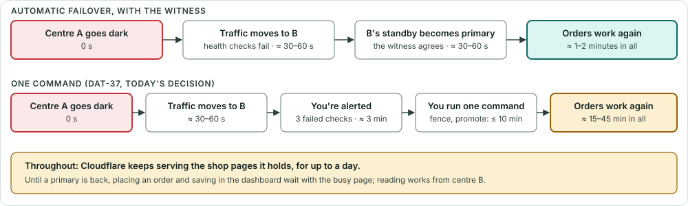

# Lytro in two data centres

Status: a proposal, 2026-11-20. The owner: "the biggest issue with one datacenter is service uptime guaranty".

With one data centre, Lytro is down whenever that building is: a power cut, a broken uplink, or the provider's own
trouble. This design runs Lytro in two data centres, at two providers in Dhaka, so that either can go dark and shops
keep selling. It builds on the lean layout (`SCALING-TO-2000-SHOPS.md`). The database and Redis layers are designed in
`DATA-LAYER.md`.

It amends the SRS and the Phase 9 plan where noted (DAT-19, DAT-37, D9-2), so each step needs the owner's approval.
Nothing here is bought or built yet.

## In short

- **What it survives:** a whole data centre going dark, including its provider's network. Either centre carries every
  shop alone.
- **Downtime when centre A fails:**
  - about **1–2 minutes** with automatic failover;
  - about **15–45 minutes** with today's one-command failover, depending on how fast someone runs it.

  Shop pages Cloudflare holds stay up throughout.
- **The cost at 2,000 shops:** about **৳1.49 lakh ($1,191) a month**, or ৳74 a shop. One centre costs ৳71,260. With
  centre B at Limda instead of Diana Host, about ৳1.16 lakh.
- **A realistic target:** **99.95% a month** (about 22 minutes down) with automatic failover. One centre manages about
  99.5% (3.6 hours). No Bangladeshi provider publishes a guarantee, so this is a target measured from outside, not a
  promise any provider backs.

## The layout

- **Each centre can carry every shop alone,** at the evening peak and through a 10× spike: 3 app servers (24 vCPU)
  against the 17 cores a spike needs.
- **Both centres run the same release.** Each reads from its own database and writes to the one primary.
- **The primary streams every change to centre B** within seconds.
- **Cloudflare, R2 and monitoring sit outside both centres,** so they're still there when either goes dark.

## When centre A goes dark

The difference between the two lanes is who decides that centre A is gone: a witness at a third provider, in about a
minute, or a person woken by an alert. Either way only one primary may ever take writes. The old one is fenced and
rejoins as a standby, never as a primary (DAT-37's rule).

## What each failure costs

| What fails | One centre (the lean layout) | Two centres, one command | Two centres, automatic |
| --- | --- | --- | --- |
| One app server | nothing: the load balancer skips it | nothing | nothing |
| The database server | 15–45 min: the standby, by one command | 15–45 min | ≈ 1–2 min |
| All of centre A | hours: new servers, restored from R2 (the 4-hour target) | browsing back in ≈ 1 min; orders in ≈ 15–45 min | ≈ 1–2 min |
| All of centre B | does not apply | nothing shoppers notice | nothing shoppers notice |
| Data lost | up to a minute (WAL reaches R2 within 60 s) | seconds | none while both run (synchronous, `DATA-LAYER.md`) |
| **Realistic monthly target** | **≈ 99.5% (3.6 hours down)** | **≈ 99.9% (43 minutes)** | **≈ 99.95% (22 minutes)** |

**What two centres can't fix:**
- **Cloudflare itself.** Both centres sit behind it. It's rare, and its Business plan promises 100% uptime with
  credits.
- **A national internet outage in Bangladesh.** Both centres are in Dhaka.
- **Outside services going down:** bKash, couriers, SMS. The circuit breakers keep orders coming in.
- **A bad release.** Both centres run the same one, though two centres let a release reach B first and A only after
  it's been watched.

## What makes it work

| Rule | How | Kind |
| --- | --- | --- |
| The app finds the primary by name | Through Patroni's health check (HAProxy, `DATA-LAYER.md`) or DAT-37's database name with a 30-second lifetime. A failover moves the name, never the apps' settings. | Ops |
| Each centre reads from its own database | `DATABASE_READ_URL`: the primary in A, the standby in B. Only writes cross the tunnel. | Setting |
| A shopper stays in one centre | The load balancer's session affinity. Kept pages and per-minute limits live in each centre's own Redis. | Setting |
| Limits stay exact where they must | Orders, codes and payment sessions are counted in PostgreSQL (RED-11). Per-minute limits are counted in each centre. | Built |
| Clearing a page clears both centres | The purge job writes each tag's change time to both centres' Redis before Cloudflare's purge (D9-33). | Code |
| Jobs run from either centre | Workers in both centres take jobs from the one queue in PostgreSQL. | Built |
| Centre B's addresses are allowed everywhere A's are | R2's backup keys are locked to our addresses (DAT-28). Providers that allow callers by address (SMS, the payment gateway, couriers) need B's too, before it's needed. | Ops |
| Backups follow the primary | Both centres hold the archive settings, so whichever server is primary sends its WAL to R2. | Ops |
| Deploys go to B first | Migrate once on the primary, replace centre B's servers, watch, then centre A's. | Code |
| Only one primary, ever | Fencing (DAT-37), or Patroni's leader lock with the witness. | Ops |
| Watched from outside | Checks from at least two places outside both centres. Alerts on standby lag over 5 s and on either pool turning unhealthy. | Monitoring |
| Drilled | Every quarter, centre A is switched off on purpose, and the time until orders work again is recorded in `docs/drills/`. | Drill |

## What it costs at 2,000 shops

Prices were read on the providers' own pages on 2026-11-20, at Bangladesh Bank's 124.75 taka to the dollar. Diana
Host's include its 5% VAT. Each centre is sized to carry every shop alone.

| A month | Centre A (CloudXen) | Centre B (Diana Host) |
| --- | --- | --- |
| App servers ×3 (8 vCPU, 16 GB) | 3 × $25.20 = ৳9,431 | 3 × ৳13,124 = ৳39,372 |
| Redis (4 vCPU, 8 GB) | $13.20 = ৳1,647 | ৳6,299 |
| Worker server | $25.20 = ৳3,144 | spare workers on the app servers |
| PostgreSQL | primary: VPS 14 vCPU / 64 GB / 1 TB, $96 = ৳11,976 | standby: VPS 24 vCPU / 64 GB / 1 TB, ৳41,999 |
| **Each centre** | **৳26,198** | **৳87,670** |

| Beside both centres | A month |
| --- | --- |
| Witness: the smallest VPS at a third provider (estimate) | ≈ ৳1,000 |
| Cloudflare: Pro, a load balancer with two pools (6 servers), Cloudflare for SaaS | $80 = ৳9,980 |
| R2: photos and backups (estimate) | ≈ ৳11,228 |
| Monitoring, with checks from several places (estimate) | ≈ ৳12,475 |
| **Total, two centres** | **≈ ৳1,48,551 ($1,191), ৳74 a shop** |
| For comparison: the lean layout in one centre | ≈ ৳71,260 ($571), ৳36 a shop |
| Centre B at Limda instead (3 × ৳7,000, ৳3,450, a dedicated 5950X at ৳30,500) | ≈ ৳1,15,831 in all |
| Cloudflare Business instead of Pro, for its 100% uptime promise | + ৳28,069 |

**Why Diana Host for centre B:**
- **A different provider,** so one company's trouble can't take both centres (DAT-19).
- **It states its international bandwidth:** 50 Mbps on the app plan, 100 Mbps on the database plan. DAT-20 asks for a
  stated figure.
- **The trade-off is cost:** about four times CloudXen per app server.
- **Limda is cheaper,** but it states no international bandwidth, and its order form defaults to a server in the US.

**At other sizes, roughly:**
- **500 shops:** one server in each centre, about ৳27,500 a month. A's server runs everything; B's holds the standby
  and a copy of the apps.
- **1,000 shops:** 2 app servers, Redis and the database in each centre, about ৳1.05 lakh.
- **5,000 shops:** plan it with its own load test.

## For the owner to decide

| Decision | Recommendation | What it changes |
| --- | --- | --- |
| Automatic failover, or keep one command | **Automatic** (Patroni, with the witness at a third provider), once both centres run and a drill has passed. A person woken at 3 am is most of the 15–45 minutes. | Amends D9-2, DAT-37 and OD-37, which chose one command and no Patroni |
| Centre B's provider | **Diana Host** (states its bandwidth), or Limda to save about ৳33,000 a month | Ask each for their international bandwidth in writing and their uptime record (DAT-20) |
| Cloudflare Pro or Business | **Pro** now; Business once shops are promised an uptime figure | Business adds ৳28,069 a month, and a 100% uptime promise for Cloudflare's part |
| When | **The standby goes to centre B on the day the database gets its own server** (step 2 of the build order, DAT-55's triggers). Centre B's app servers follow at step 3. | DAT-19's second phase, in two steps |

## Sources

- **Design:**
  - the lean layout and its estimate (`SCALING-TO-2000-SHOPS.md`);
  - staging's load runs (`SYSTEM-UNDER-LOAD.md`);
  - DAT-19, DAT-20, DAT-28, DAT-37, DAT-55 and D9-2.
- **Downtime figures are estimates:**
  - health checks every 30–60 seconds;
  - a witness's decision in about the same;
  - an operator's response at night of 10–30 minutes.
- **Uptime targets:** what this design can reasonably reach, measured from outside. They aren't guarantees any
  provider backs.
- **Prices**, read on 2026-11-20 from CloudXen, Diana Host, Limda, Cloudflare, Grafana Cloud, Sentry and UptimeRobot.
  The witness's price is an estimate. Prices change, so check them before buying.
